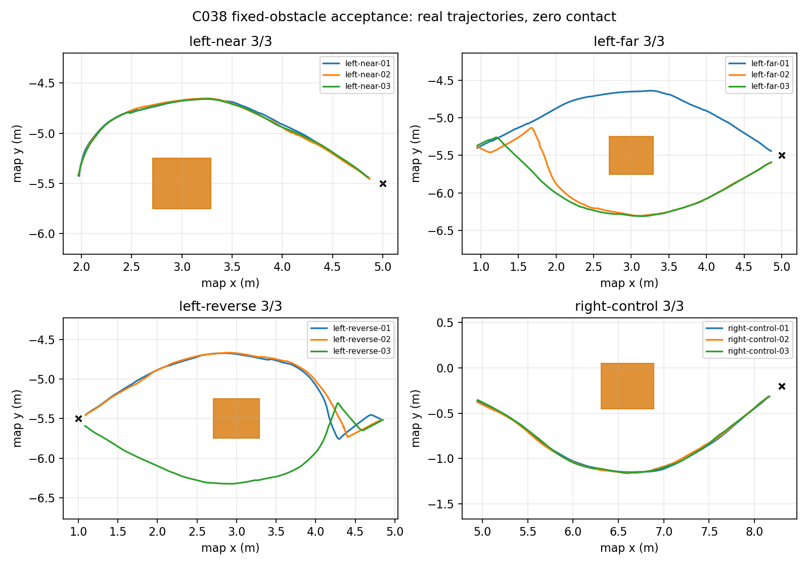
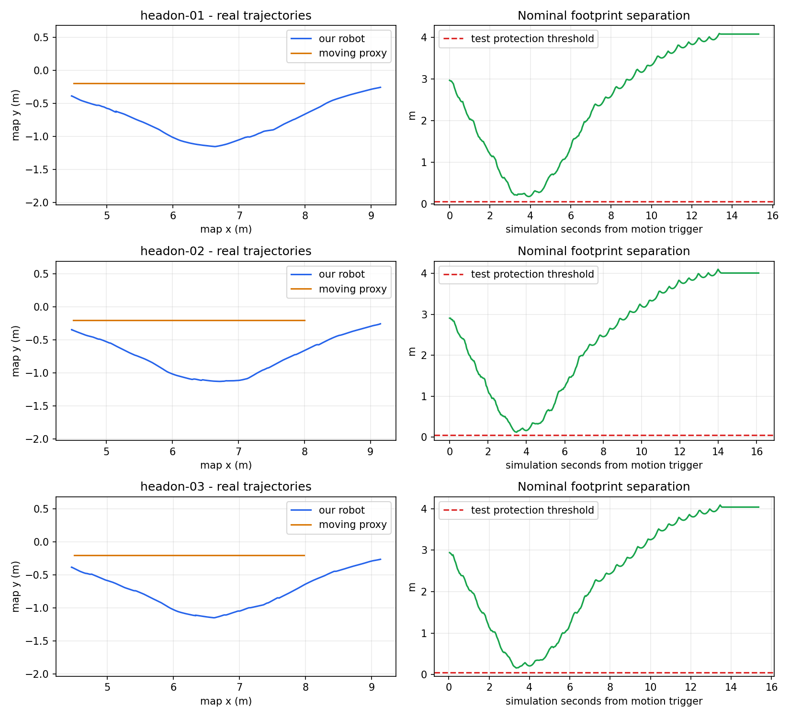

# C038：接近最低速度候选与规定避障验收

Codex，2026-10-22。证据根目录E:/RMULArtifacts/pb2025_nav_ws/completion-C038，普通配置SHA256=38f99505fff17660a639ec6239998b627bba04a5def96a0375ada738d352b9b3。

| 检查 | 结果 |
| --- | --- |
| 两次全新至中心路线预检 | 各4/4，原1秒全零通过 |
| 固定四类各3次 | 12/12，真实接触0 |
| 单物体0.5m/s对向3次 | 3/3，真实接触/保护0 |
| 普通完整路线 | 8/8，原1秒全零通过 |
| 停放移除 | 避障到点、移除后双图旧位置0 |
| 完全封路 | 自主ABORTED、全零停、无真实接触；移除双图0、新目标到点 |

固定最大真值误差0.191817522m、名义最小净距0.116084527m。移动最大真值误差0.174286726m、名义最小净距0.118822662m；对手实测0.500115744 / 0.500116113 / 0.499933978m/s。完整路线最大真值误差0.189227013m。全部已记录原1秒快照最大平移0.002931116m/s、角速0.000000360rad/s，均<原0.03；连续0.2秒稳定检查是追加条件，固定2秒预算不能挽救原1秒失败。180秒、估计/真值0.35m、0.05m保护保持。

## 本轮单项变更

C038相对C037只将controller_server.FollowPath.min_approach_linear_velocity从0.1改为0.05m/s。该值在既有控制器中也参与曲率最低速度下界，故本轮重新执行全部规定避障；额定0.5m/s、自旋策略、感知/地图、定位、几何和判据保持。没有修改PI或控制器算法。

继承C036运动追加3.14rad/s、零输入不追加的策略；继承C037按LaserScan源时间戳TF过滤未膨胀车体footprint内自身点。外部点保留源frame/时间戳，TF缺失时不发布未过滤回退并计数。5项过滤ROS契约复用C037同一转换器代码，4组速度、10项接触判读与共享内存契约复用未变组件；本轮实际日志确认过滤已启用且确实删除自身点。

独立审计核对每个真实碰撞对及正对照、目标终态、时限/误差、源观测/双图和实际停车。只有显式探针对排除，混合行不能凭probe标记整体忽略。物体真值仅驱动和评估代理，不注入导航。共享内存清理只处理本轮确证归属、身份不变且内核lease确认无FD/mmap的段，未知和活跃段保留。

## 保留的失败与解释边界

[C035](C035-RESULTS.zh-CN.md)完全无自旋反向危险逼近、[C036](C036-RESULTS.zh-CN.md)完整路线规划失败、[C037](C037-RESULTS.zh-CN.md)中心原1秒平移0.055978894m/s失败及一次预定位瞬态占用ABORTED全部保留；C034原1秒0.270823m/s仍失败。C027/C029反向碰撞及C033清除失败也保留。后续通过不覆盖这些失败，不证明已定位所有瞬态占用或自身回波是唯一根因。

普通默认仅在本轮全部门禁完成后采用，旧C034普通配置及C036/C037候选保存在history。fast保持C025配置，本轮新避障结论不覆盖fast。复现按README的固定→同参数固定通过文件约束的移动→完整路线→parked/blocked顺序；使用全新record-dir、既有容量守护，默认不录bag。完整JSON和两张真实轨迹图随报告发布。

本结论只覆盖四类固定场景、单个0.58×0.50×0.50m脚本盒体的0.5m/s预设对向轨迹及规定回归。净距为名义几何估计，实际接触以正对照后的真实接触传感器为准。未验证横穿、多车、全场任意目标、Venom实车或战术。一套后台Gazebo，无RViz/整段bag；50/40/30GiB与既有单轮/累计预算保持。

## 收尾记录

本轮20个自有启动日志目录经逐文件SHA校验迁至E盘，原导航日志路径保留可读；156个日志/轨迹文件无损gzip由121,368,435字节压至19,389,525字节，校验解压SHA后才移除重复原格式，节省约97.25MiB。另移除2个各294,192字节的可重建诊断actor，记录源码与SHA。详见[C038清理清单](C038-cleanup.json)。C035/C036为并行离线审计保留原格式，C037及更早失败证据保持；没有删除旧原始数据或压缩VHD。

结束现场未发现项目worker、Gazebo或RViz。Windows实测D133.55GiB、E60.76GiB；文件整理释放的Linux逻辑空间不等于D盘VHD物理回收。47份目标后原1秒快照的四项实际速度/指令检查均通过，不将快照数当独立场景数。
