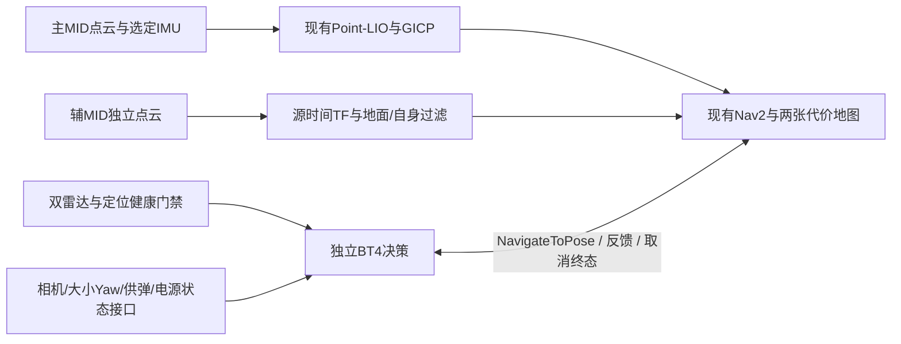

# C069：最终哨兵硬件与软件改造计划

状态：最终配置已锁定，硬件契约及接口模板已实现、16项逻辑通过；双MID360运行改造及整机联调尚未实施。以用户2026-10-30指定的《机械组技术报告1029.pdf》为本轮最终硬件依据。10页均已渲染目视核对；原PDF文本编码提取异常，乱码文本不作为事实依据。PDF SHA256：680b82bb24eea3d10c64084c26c9c4a8cc3723620a9bea05c3b1d148ff7d0424。

## 1. 当前版本与采用边界

从原双雷达软件基线79db2b63297be8b96d8d362a66cf5d0c734b63c1继续，主仓库src/pb2025_sentry_nav，分支sim/rmul2027-3v3。保留C062决策BT4/导航BT3隔离、可靠Nav2 Action、C063长路径改进、C064受控IMU恢复及C067时序修复。原dirty和生产安装保留，不reset/clean、不改main或上游。

原双雷达实际是1台MID360＋1台RPLidar A2，不等于最终2台MID360。当前MecanumDrive2是历史麦克纳姆仿真，也不等于报告的全向轮独立悬挂实车。原成绩只保留原范围，不能直接宣布最终硬件通过。

用户明确要求忽略C068单雷达实验，故该工作树、源码和证据封存，不合并、不作为C069的功能或验收前提。新增主动观测/速度门原型也不带入本轮。C068并未完成全部同版验收。

## 2. 最终硬件清单

| 子系统 | 报告确定内容 | 软件影响与当前状态 |
| --- | --- | --- |
| 激光雷达 | 2台MID-360；布局需减少车体/云台遮挡，覆盖平地导航避障 | 替换旧RPLidar通路，按设备分点云话题、帧、时间戳和健康状态；安装外参尚无数值 |
| IMU | 早期用户已明确有IMU；本报告没有指定独立外置IMU型号/数量 | 保留既有主雷达IMU→Point-LIO链路；不把两路未同步IMU直接并入同一LIO |
| 工业相机 | 1台；与发射机构保持稳定相对位置 | 设备型号、驱动、内参、相机到发射机构标定待确定；接口纳入清单，不冒充视觉已实现 |
| 计算 | 1台Jetson Orin | 明确ARM64目标；具体SKU、JetPack/系统及原生构建/性能待验，WSL/x86不能替代 |
| 供电 | 超级电容，设备应留散热、防护、接线、拆装空间 | 需要电池/超电/可用功率反馈；通信协议未确定，不凭空设置电压阈值 |
| 底盘 | 全向轮、独立悬挂、DJI M3508＋行星减速机构；平移/原地与平移小陀螺 | 底盘Twist接口可沿用；轮径、减速比、质量、惯量、悬挂行程、整车包络待测；不得把麦轮动力学写成实车等效 |
| 云台 | 大小Yaw；大Yaw连续360°，小Yaw有限位且需大Yaw协同回中 | 分离大小Yaw反馈和控制所有权；小Yaw限位未给出，不能拿俯仰范围代替 |
| 俯仰 | 作战覆盖目标−20°～＋25° | 记录为报告目标，实际编码器零位和机械安全限位需装配标定 |
| 供弹/发射 | 17mm、中心供弹、500发；台架射频≥18Hz；满/半/尾弹，静止/平移/小陀螺都要验证；卡弹支持反转解卡 | 弹量、热量、卡弹和机构反馈接口列入计划；18Hz不是比赛无条件持续射频；实际发射未启用 |
| 射击精度目标 | 静止7m，散布在小装甲板范围内 | 独立实机验收，不用导航仿真代替 |

速度目标3.6m/s对应满载整车台架测试，并注明关闭超电放电、底盘功率限制100W。这是机械目标，不自动改动已验0.5m/s，也不自动重开fast。原地小陀螺10分钟×3轮是实机耐久目标。

报告第2章的555×555×240mm、过洞/折叠机构和步兵俯仰范围不属于哨兵；第4章重装的麦克纳姆底盘、六自由度机械臂也不移植到哨兵。

## 3. 双MID360接入顺序

1. 先按设备建立primary/auxiliary标识、连接信息、独立话题和传感器帧。保留主链livox/lidar、livox/imu的兼容入口；辅链用auxiliary/livox/lidar、auxiliary/livox/imu。两设备不共用一个未经校正的livox_frame。
2. 当前锁定livox_ros_driver2支持multi_topic配置，但默认launch的frame_id是全局值。仅打开multi_topic不代表外参/坐标已经正确；须建立设备到帧绑定，并明确SDK外参与TF只能有一处实际变换，避免重复变换。
3. 第一版保留单一主MID＋单一IMU的Point-LIO/GICP，不同时移植新定位或贸然进行两路原始点云/IMU融合。辅MID先作为按源时间戳变换的独立补充障碍输入，补齐地面/自身过滤和标记/清除验证。
4. 主辅雷达分别校验数据推进、接收/源时间、TF和遮挡；必需来源过期进入现有“取消目标→确认终态→验证实际停车”路径。恢复必须重新满足定位质量与感知门禁，不能收到话题就当到点。
5. 雷达装在底盘还是转动云台，报告未给出标定定义。未测的parent/xyz/rpy保持null；随动安装必须使用源时间动态TF，不先写死为底盘静态安装。现有挂载不擅改，不按渲染图猜毫米数据。

此图为改造架构，不代表所有箭头已经实现。相机、云台、供弹和电源都保留接口工作项；本轮已验软件能力仍以导航/决策历史实际证据为准。

## 4. 具体推进计划与验收

| 阶段 | 工作 | 完成证据 |
| --- | --- | --- |
| P0 硬件契约 | 固定最终清单、来源与边界，拒绝错雷达、重复帧/话题、双IMU误接及未知外参部署 | 已完成清单/校验/接口模板，16项逻辑通过 |
| P1 双MID通路 | 主辅设备独立发布、帧绑定、时间与IMU来源，保留主LIO；辅链地面/自身过滤、两图占用和清除 | 尚未运行；先独立逻辑/消息stub，后单套2027低速仿真 |
| P2 实际机构接口 | 全向底盘与独立悬挂参数、M3508执行/反馈、大小Yaw/Pitch、相机关系、电源/卡弹状态 | 未实施；装配实测与协议落表，不重复索取用户没有的布局资料 |
| P3 导航/决策闭环 | 等待→驻守/巡逻→撤退/切换→恢复→结束/异常停车；单目标、去重、取消失败/超时、拒绝/失败和有限重试 | 重用同源逻辑与Action负向契约，但新硬件必须重新联调 |
| P4 报告整机目标 | 每轮5分钟、连续3轮完成导航/避障/巡逻/占点，记录故障并排除后复测；识别射击另列未实现项 | 旧短演示、8段路线和单轮成功不能顶替3×5分钟；仿真/墙钟分别记录 |
| P5 Orin/实车 | 原生构建、实际频率/时延/温度/资源、丢传感器/急停/定位失败停车；轮地接触/打滑/悬挂、机构联动和实机耐久 | 均未验；当前WSL结果不作为实车动力学或Orin验收 |

每次只运行一套导航/仿真，fast保持后置。4GiB任务、512MiB/1800s单轮、宿主/产物盘50/40/30GiB保护保持；显式record-dir必须计入增长监控。保留全部原始失败，不放宽0.35m/180秒/1秒内速度与命令全分量0.03等现有适用门槛。

## 5. 已落地文件与状态

- config/hardware/rmul2027_sentry_final_20261029.yaml：完整最终硬件及待测字段。
- config/hardware/dual_mid360_interface.template.yaml：独立点云/IMU、帧和健康策略模板，明确NON_DEPLOYABLE_INTERFACE_TEMPLATE。
- final_hardware_contract.py：清单一致性、实车前置条件校验、PDF指纹校验、旧模型审计和模板生成，不启动ROS或发送控制命令。
- tests/final_hardware_contract_test.py：16项检查覆盖错雷达、少设备、重复帧/话题、双IMU、擅开fast、混用步兵指标、未标定却放行、主链兼容和旧模型差异。

| 类别 | 当前状态 |
| --- | --- |
| 已实现 | 最终硬件清单、逻辑预检、接口模板、旧模型差异核对 |
| 构建通过 | 本轮没有改动或重建C++导航/决策运行库；Python模块已实际运行，不把解释执行冒充ARM或整车构建 |
| 逻辑通过 | 16/16；真实部署前置条件仍有缺项，校验应拒绝而非放行 |
| 联调通过 | C069双MID360新硬件联调尚未运行；C067为旧MID＋RPLidar历史基线 |
| 失败 | 当前预检发现旧模型不符是实际差异；C068的失败及未完成回归按原样封存，不作为本轮通过证据 |
| 未运行 | 双MID接入/全套Action联调/3×5分钟/Orin/实车/正式裁判协议/fast/视觉自瞄与实际发射/新定位移植 |

当前报告没有给出两MID的位置姿态、整车尺寸质量、轮径减速比/悬挂参数、小Yaw限位、Orin具体SKU和电控协议。软件可先继续独立接口与测试开发；实车启动在实测与协议齐备前保持拒绝，不用猜值补齐。
